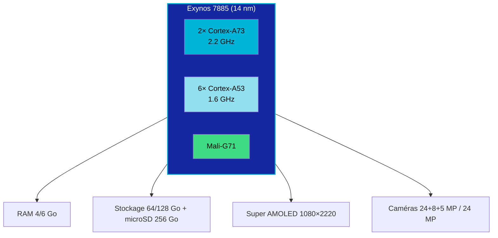
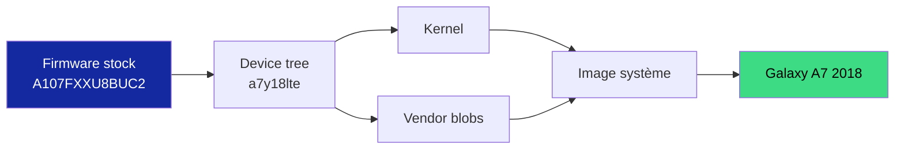
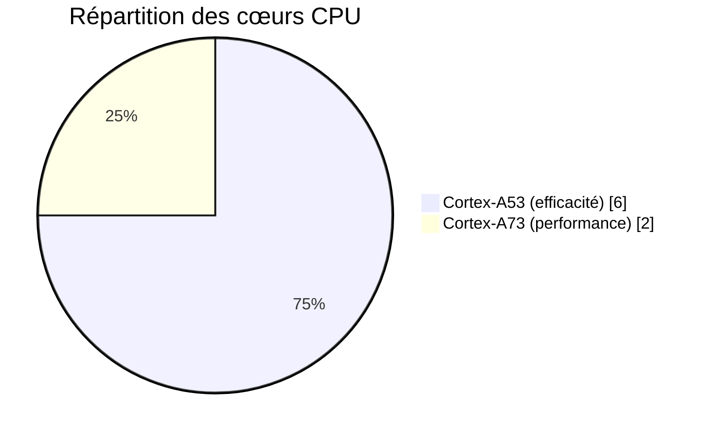
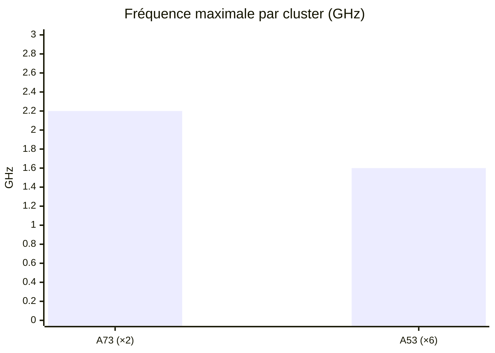
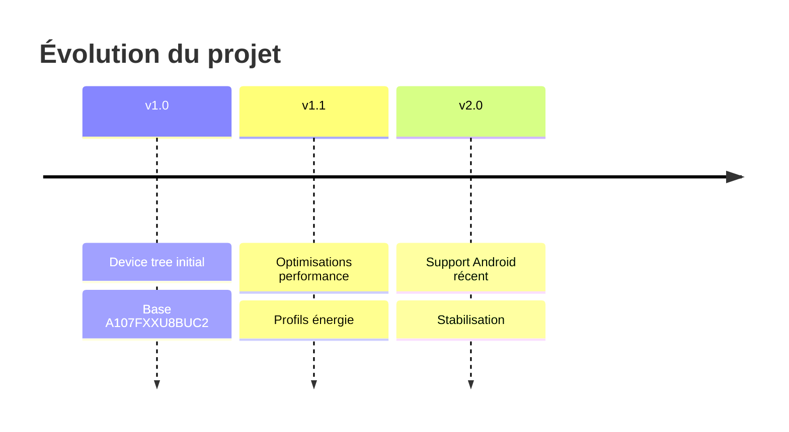

<div align="center">


<a href="https://github.com/USER/Samsung-a7y18lte-device">
  
</a>

<br/>


</div>

---

## 📑 Sommaire

| # | Section | Description |
|:-:|:--------|:------------|
| 1 | [📱 Aperçu](#-aperçu) | Présentation du projet |
| 2 | [📊 Fiche technique](#-fiche-technique) | Spécifications matérielles |
| 3 | [🧠 Architecture](#-architecture) | Schéma du SoC et de la pile logicielle |
| 4 | [⚡ Performance](#-performance) | Graphiques et optimisations |
| 5 | [🛠️ Compilation](#️-compilation) | Mise en route |
| 6 | [🗺️ Feuille de route](#️-feuille-de-route) | Planning |
| 7 | [🤝 Contribuer](#-contribuer) | Guide de contribution |
| 8 | [🙏 Crédits](#-crédits) | Sources et firmware |

---

## 📱 Aperçu

Ce dépôt contient la **configuration device** du **Samsung Galaxy A7 (2018)**, nom de code `a7y18lte`. Il est basé sur le firmware stock `A107FXXU8BUC2`.

> [!NOTE]
> Ce projet est destiné aux développeurs et aux mainteneurs de ROM. Sauvegardez vos partitions (EFS, modem) avant toute modification.

<div align="center">
  
  <br/><sub><i>Samsung Galaxy A7 (2018)</i></sub>
</div>

---

## 📊 Fiche technique

| 🔧 Catégorie | 📋 Spécification |
|:-------------|:-----------------|
| **🧠 CPU** | Octa-core : 2×2.2 GHz Cortex-A73 + 6×1.6 GHz Cortex-A53 |
| **⚙️ Chipset** | Samsung Exynos 7885 (14 nm) |
| **🎮 GPU** | Mali-G71 |
| **💾 Mémoire** | 4 / 6 Go |
| **🤖 Android d'origine** | 8.0 Oreo |
| **📦 Stockage** | 64 / 128 Go |
| **🗂️ MicroSD** | Jusqu'à 256 Go |
| **🔋 Batterie** | 3300 mAh (non amovible) |
| **📐 Dimensions** | 159.8 × 76.8 × 7.5 mm (6.0", 91.4 cm²) |
| **🖥️ Écran** | 1080 × 2220 px, 6.0" Super AMOLED, 18.5:9 (~411 PPI) |
| **📷 Caméra arrière** | 24 MP + 8 MP + 5 MP, flash LED |
| **🤳 Caméra avant** | 24 MP |
| **📅 Sortie** | Septembre 2018 |
| **🔥 Firmware de base** | `A107FXXU8BUC2` |

---

## 🧠 Architecture





---

## ⚡ Performance





### Pistes d'optimisation

- [ ] Gouverneur CPU et profils big.LITTLE adaptés
- [ ] Ajustement du ZRAM et du I/O scheduler
- [ ] Optimisation GPU Mali-G71 (rendu HWUI)
- [ ] Réduction de la consommation en veille (batterie 3300 mAh)
- [ ] Nettoyage des propriétés `build.prop` inutiles

---

## 🛠️ Compilation

```bash
git clone [https://github.com/USER/Samsung-a7y18lte-device.git](https://github.com/USER/Samsung-a7y18lte-device.git) device/samsung/a7y18lte
cd device/samsung/a7y18lte
```

> [!TIP]
> Ajoutez ce dépôt dans votre `local_manifests` puis lancez `repo sync` avant de compiler.

---

## 🗺️ Feuille de route



---

## 🤝 Contribuer

1. Forkez le dépôt
2. Créez une branche : `git checkout -b feature/ma-fonction`
3. Commitez : `git commit -m "feat: description"`
4. Poussez et ouvrez une Pull Request

---

## 🙏 Crédits

- Firmware de base : **A107FXXU8BUC2**
- Image : [GSMArena](https://www.gsmarena.com/)
- Badges : [Shields.io](https://shields.io)

<div align="center">


* ***Based on Samsung Galaxy A7 2018***

</div>
